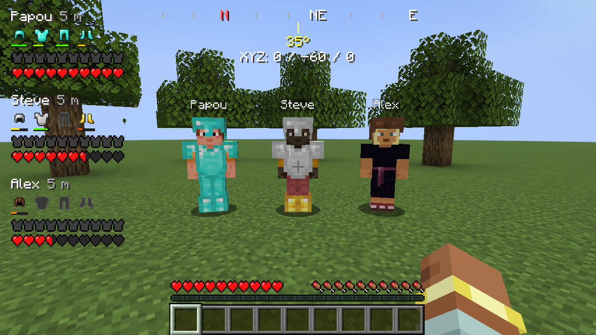
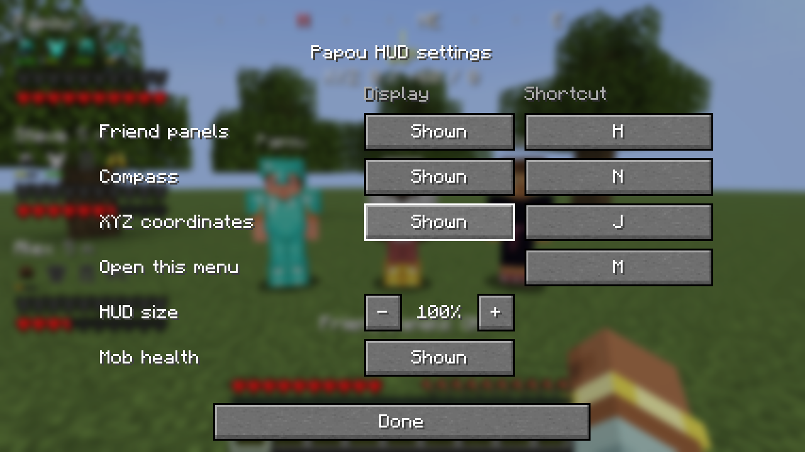
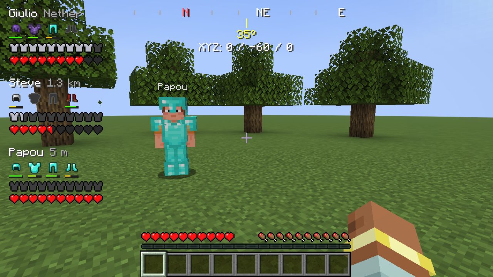
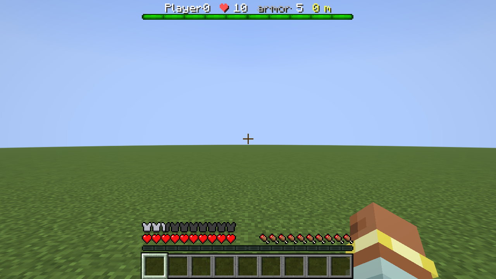
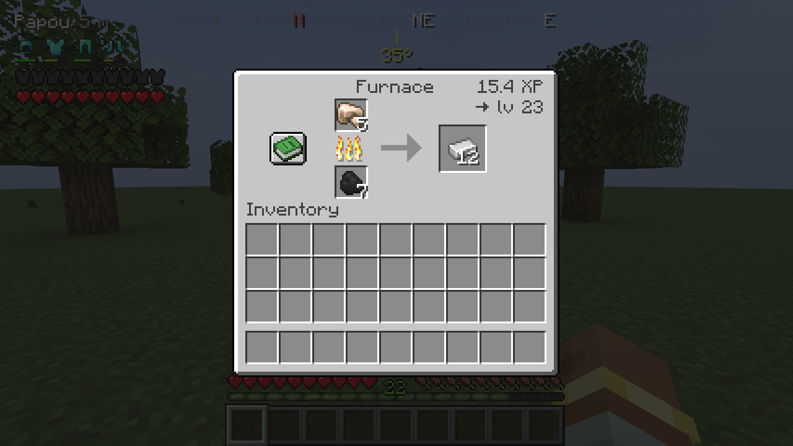
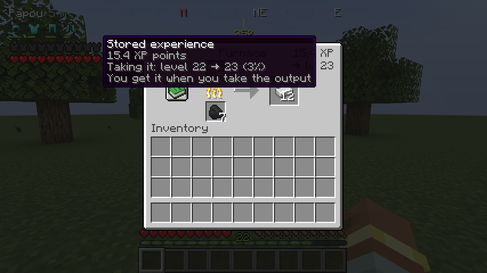
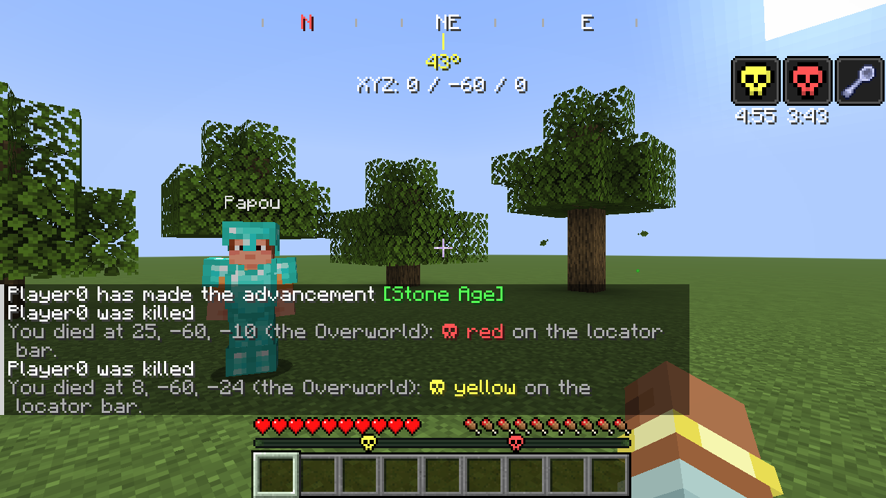
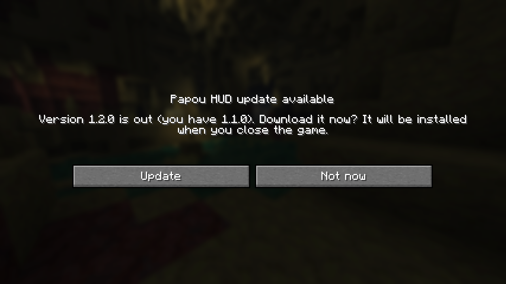

# Papou HUD

A client-side [Fabric](https://fabricmc.net/) mod for Minecraft that adds a small, toggleable HUD for playing with friends:

- **Friend panels** – one panel per player in the top-left corner, showing their name, how far away they are (or which dimension they're in), the four armor pieces they are wearing (with durability bars), their armor points and their hearts. With Papou HUD on the server too, the panels show everyone online, however far away (see [Friends far away](#friends-far-away)).
- **Compass** – a strip at the top of the screen with cardinal/intercardinal directions (north in red) and the current heading in degrees.
- **XYZ coordinates** – your block position, right below the compass.
- **Settings menu** – show or hide each element and rebind every shortcut in game.
- **Furnace XP** – furnaces, smokers and blast furnaces show how much XP they are holding, next to their title.
- **Death marker** – after you die, a skull on the locator bar points to where you died for 5 minutes, with a reminder in chat every minute.
- **Inventory Sorter on any server** – with [Inventory Sorter](https://modrinth.com/mod/inventory-sorting) set to "Sort by: Category", chests are sorted by category on servers without Inventory Sorter too, such as Paper (see [Inventory Sorter](#inventory-sorter)).
- **Update check** – when a new version is released, a popup at startup offers to install it.



Everything works on any server, including vanilla ones, with nothing installed server-side, except the furnace XP and the panels for friends far away. Without help from the server, the friend panels show only the players your client already knows about, i.e. those within render/loading distance.

## Requirements

| Component     | Version     |
| ------------- | ----------- |
| Minecraft     | 26.3        |
| Fabric Loader | ≥ 0.19.3    |
| Fabric API    | any for 26.3 (built against 0.166.2+26.3) |
| Java          | 25          |

## Installation

1. Install [Fabric Loader](https://fabricmc.net/use/) for Minecraft 26.3.
2. Download [Fabric API](https://modrinth.com/mod/fabric-api) for 26.3.
3. Download `papouhud-<version>.jar` from the [Releases](https://github.com/vittoriopippi/papou_mc/releases) page.
4. Put both jars in your `.minecraft/mods` folder and launch the game with the Fabric profile.

## Controls

| Action                 | Default key |
| ---------------------- | ----------- |
| Toggle friend panels   | `H`         |
| Toggle compass         | `N`         |
| Toggle XYZ coordinates | `J`         |
| Open settings menu     | `M`         |

Shortcuts only fire while you are in game with no screen open. Toggling an element shows a short ON/OFF message above the hotbar.

In the settings menu, click a shortcut and press the new key. `Delete` or `Backspace` clears it (no key), `Esc` cancels. The **HUD size** row makes the friend panels, compass and coordinates smaller (`-`) or bigger (`+`), from 50% to 150%; the rest of the game's interface stays as it is.



## Friends far away

On its own, your game only knows about the players within loading distance, so their panels disappear as soon as they walk away. When the server has Papou HUD too, it sends everyone's name, position, hearts and armor to the players who have the mod, about twice a second. The panels then show every player online, at any distance and in any dimension. Next to the name, the panel shows how far away they are (e.g. `1.3 km`), or the dimension they're in if it isn't yours.



- **Singleplayer, Open to LAN, Essential:** the world runs inside the host's game, so it works as long as the **host** has Papou HUD.
- **Dedicated Fabric server:** put `papouhud-<version>.jar` (and Fabric API) in the server's `mods` folder.
- **Paper server:** put `papouhud-paper-<version>.jar` from the same release in the server's `plugins` folder. It needs Paper for the same Minecraft version.
- **Any other server:** the panels show only the players nearby, as before.

The vanilla locator bar (above the hotbar) already shows the direction of the other players.

### Players without the mod (Bedrock, Xbox)

Bedrock players (Xbox, phone, Windows Bedrock, joining through [Geyser](https://geysermc.org/)) can't install Fabric mods, so the Paper plugin gives them, and any Java player without Papou HUD, a **bar at the top of the screen for each friend**. The bar shows the friend's name, hearts, armor points, and the distance with an arrow pointing to them (↑ = straight ahead), or the dimension they're in. The bar itself empties as the friend loses health, and turns yellow, then red. Up to 4 friends are shown, nearest first.



- Type `/papou` to hide the bars, and again to bring them back (remembered per player).
- The text is in Italian for players whose game is in Italian, in English otherwise.
- Players with Papou HUD get the panels instead and never see the bars.
- The Fabric server part doesn't show bars: on a Fabric server, everyone has a Java game with the mod.

## Furnace XP

When you open a furnace, smoker or blast furnace, the amount of XP it has stored (e.g. "15.4 XP") appears on the title row, aligned to the right, in the same style as the title. That's the XP you get when you take the output. Hover over it for a short explanation. Nothing is shown while the furnace holds no XP.

| Stored XP on the title row | Tooltip on hover |
| --- | --- |
|  |  |

Stored XP only exists on the server: the game never sends it to players. Papou HUD therefore reads it on the server side and sends it to players who have the mod:

- **Singleplayer** works out of the box.
- **Hosting with Essential or Open to LAN**: the world runs inside the host's game, so it works as long as the **host** has Papou HUD. Each friend also needs the mod to see the number.
- **Dedicated server**: install Papou HUD in the server's `mods` folder as well.

On a server without the mod the XP line simply doesn't appear, and everything else keeps working. The Paper plugin doesn't send it either. The value is the exact total; when you take the output, the game rounds any fraction randomly (e.g. 15.4 gives 15 XP, or 16 with a 40% chance).

## Death marker

When you die, a skull appears on the locator bar (the bar above the hotbar that shows other players). It points to the exact spot where you died, so you can walk back and pick up your items.



- **Chat:** right after you respawn, the chat shows where you died. Then every minute it repeats how far away the spot is and how many minutes are left.
- **Duration:** after 5 minutes the skull disappears with a last message. That's the same time dropped items take to despawn. The timer follows game time, so pausing in singleplayer pauses it too.
- **Other dimensions:** the skull only shows in the dimension where you died. Elsewhere, the reminders tell you which dimension it was in.
- **Dying again:** if you die again, the marker moves to the new spot and the 5 minutes restart.
- **Locator bar:** right after respawning, the game shows the XP bar for a few seconds before switching back to the locator bar.

Everything happens in your own game, so it works on any server and with Essential. To turn it off, set `"deathMarkerEnabled": false` in the config file.

## Inventory Sorter

[Inventory Sorter](https://modrinth.com/mod/inventory-sorting) can sort by name or by category ("Sort by: Category", the same order as the creative inventory: building blocks, then natural blocks, tools, food and so on). To switch, hover over its sort button in a chest and scroll the mouse wheel; the tooltip shows the current method.

On a server without Inventory Sorter, such as Paper, the mod sorts from your own game, and sorting by category needs the creative inventory's tabs. Minecraft fills those only when you open the creative inventory, so in survival they stay empty and every chest comes out in alphabetical order instead. Papou HUD fills them when you join a server, so "Sort by: Category" works there too. In singleplayer, and on Fabric servers with Inventory Sorter, the server does the sorting and nothing changes.

## Updates

At startup the mod checks this repository's [latest release](https://github.com/vittoriopippi/papou_mc/releases/latest). If it is newer than the installed version, a popup appears once, on the main menu:



- **Update** downloads the new jar next to the current one, under a name Fabric ignores (`papouhud-update.jar.download`). When you close the game, the old jar is replaced with the new one, and the next launch runs the new version. On Windows the running jar is locked, so a small hidden PowerShell process does the swap right after the game exits.
- **Not now** closes the popup. You will be asked again at the next launch.

The download is only accepted if it is a Papou HUD jar with the version the release announces, made for the Minecraft version you are playing. A release for a newer Minecraft is refused with a message saying which version it needs, so the mod you have keeps working. If anything fails (no internet, a locked file), the old version stays installed and untouched. If the download page cannot be determined automatically, the popup offers to open the release page instead.

To turn the check off, set `"checkForUpdates": false` in the config file (see below). Versions before 1.1.0 do not have the update check, so update those by hand once.

Versions up to 1.3.0 are for Minecraft 26.2 and 1.4.0 is for 26.3. Since 1.3.0 doesn't load in a 26.3 game, install 1.4.0 by hand when you move to 26.3.

## Configuration

Settings are saved automatically to `config/papou.json` in your game directory:

```json
{
  "panelsEnabled": true,
  "compassEnabled": true,
  "coordsEnabled": true,
  "checkForUpdates": true,
  "deathMarkerEnabled": true,
  "hudScale": 100,
  "configVersion": 3,
  "keyPanels": 11,
  "keyCompass": 17,
  "keyCoords": 13,
  "keyMenu": 16
}
```

`hudScale` is the size of the friend panels, compass and coordinates in percent, from 50 to 150 (the `-` and `+` buttons in the settings menu change it by 10). Keys use Minecraft's key codes, which since Minecraft 26.3 are SDL scancodes (e.g. `M` = 16); `-1` means no key. If the file is missing or unreadable, the defaults are used.

The mod is translated into English and Italian.

## Building from source

You need JDK 25. Then:

```bash
./gradlew build
```

The mod jar is written to `build/libs/papouhud-<version>.jar` and the Paper plugin to `paper/build/libs/papouhud-paper-<version>.jar`. `build` also runs the unit tests (`./gradlew test`), which check that the mod and the plugin write the friends packet byte for byte the same way, against [`src/test/resources/players-v1.hex`](src/test/resources/players-v1.hex). To start a development client with the mod loaded:

```bash
./gradlew runClient
```

The mod version is set in [`gradle.properties`](gradle.properties). To publish a release, write its notes in `release-notes/v<version>.md`, then push a `v<version>` tag: the [release workflow](.github/workflows/release.yml) builds both jars, runs the tests and publishes the release with `papouhud-<version>.jar` (the jar the update check downloads), its sources and `papouhud-paper-<version>.jar`.

The README screenshots are produced by a [client game test](src/gametest/java/com/giulio/papouhud/ScreenshotGameTest.java), which opens a game window, sets up the scene and saves them to `build/run/clientGameTest/screenshots`:

```bash
./gradlew runClientGameTest
```

The same run also checks that the built-in server sends the friends packet with the right armor. To check a real Fabric or Paper server, run the test against it: [`ServerGameTest`](src/gametest/java/com/giulio/papouhud/ServerGameTest.java) explains what the server needs (a second player wearing known armor, or the `-Dpapouhud.debug.includeSelf=true` switch when the test player is alone):

```bash
PAPOUHUD_TEST_SERVER=127.0.0.1:25590 PAPOUHUD_TEST_FRIEND=Giulio PAPOUHUD_TEST_EXPECT_BARS=1 ./gradlew runClientGameTest
```

## License

Released under [CC0 1.0](https://creativecommons.org/publicdomain/zero/1.0/) (public domain), as declared in `fabric.mod.json`.
