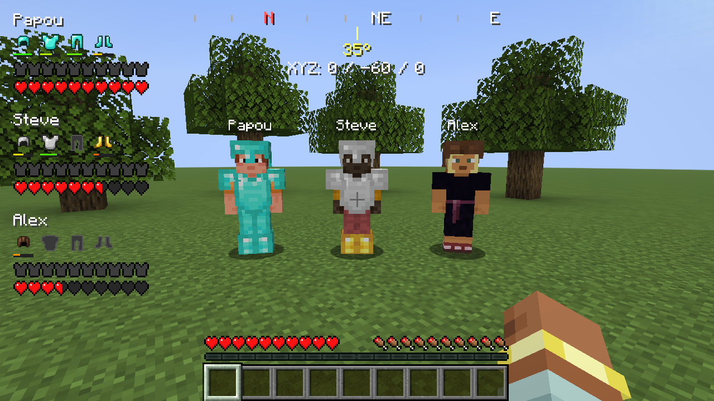
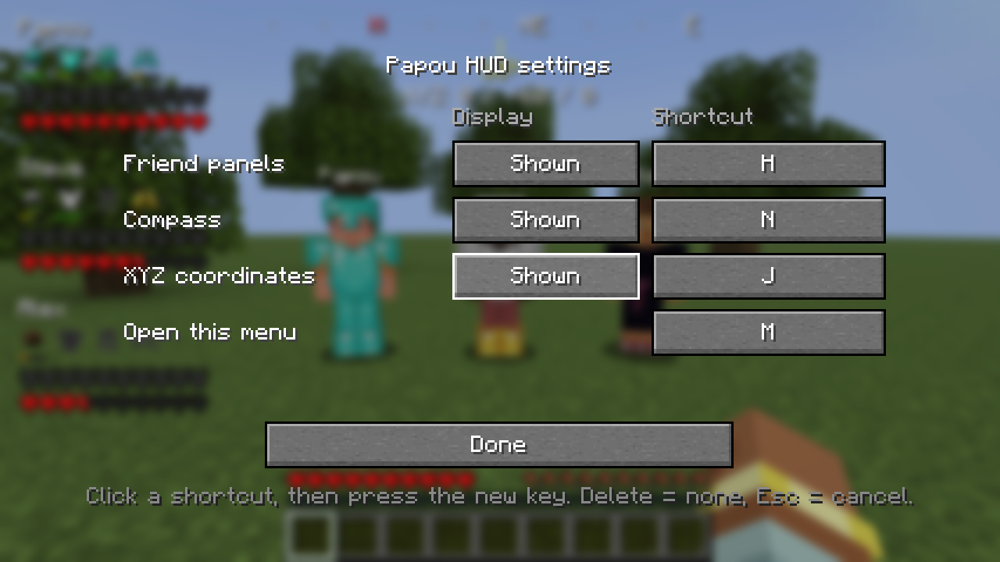
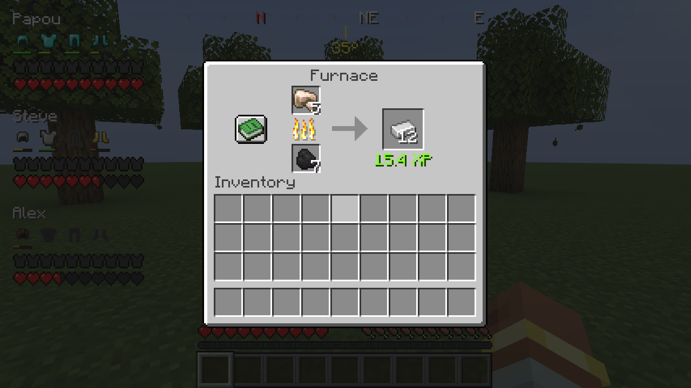
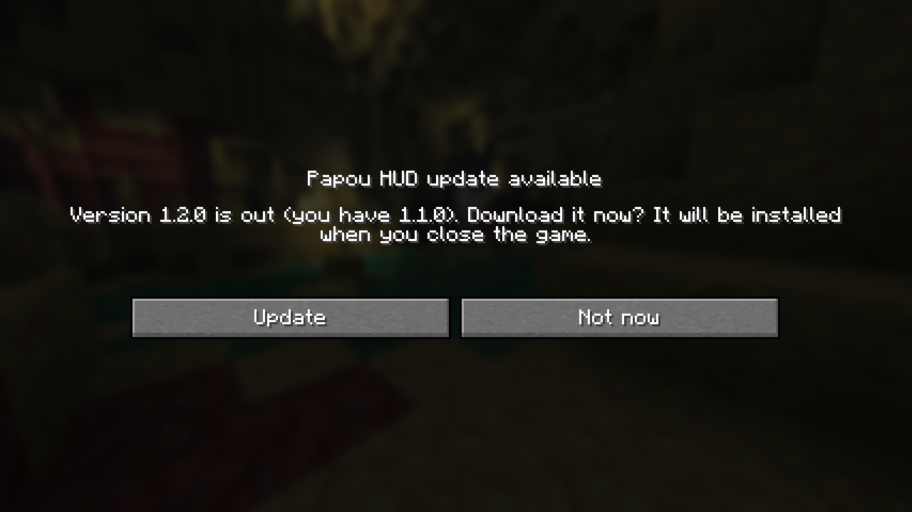

# Papou HUD

A client-side [Fabric](https://fabricmc.net/) mod for Minecraft that adds a small, toggleable HUD for playing with friends:

- **Friend panels** – one panel per nearby player in the top-left corner, showing their name, the four armor pieces they are wearing (with durability bars), their armor points and their hearts.
- **Compass** – a strip at the top of the screen with cardinal/intercardinal directions (north in red) and the current heading in degrees.
- **XYZ coordinates** – your block position, right below the compass.
- **Settings menu** – show or hide each element and rebind every shortcut in game.
- **Furnace XP** – furnaces, smokers and blast furnaces show how much XP they are holding, under the output slot.
- **Update check** – when a new version is released, a popup at startup offers to install it.



Everything except the furnace XP works on any server, including vanilla ones, with nothing installed server-side. Friend panels show the players your client already knows about, i.e. those within render/loading distance.

## Requirements

| Component     | Version     |
| ------------- | ----------- |
| Minecraft     | 26.2        |
| Fabric Loader | ≥ 0.19.3    |
| Fabric API    | any for 26.2 (built against 0.161.0+26.2) |
| Java          | 25          |

## Installation

1. Install [Fabric Loader](https://fabricmc.net/use/) for Minecraft 26.2.
2. Download [Fabric API](https://modrinth.com/mod/fabric-api) for 26.2.
3. Download `papouhud-<version>.jar` from the [Releases](https://github.com/vittoriopippi/papou_mc/releases) page.
4. Put both jars in your `.minecraft/mods` folder and launch the game with the Fabric profile.

## Controls

| Action                 | Default key |
| ---------------------- | ----------- |
| Toggle friend panels   | `H`         |
| Toggle compass         | `N`         |
| Toggle XYZ coordinates | `J`         |
| Open settings menu     | `M`         |

Shortcuts only fire while you are in game with no screen open. Toggling an element shows a short ON/OFF message above the hotbar.

In the settings menu, click a shortcut and press the new key. `Delete` or `Backspace` clears it (no key), `Esc` cancels.



## Furnace XP

When you open a furnace, smoker or blast furnace, the XP it has stored appears in green under the output slot. That's the XP you get when you take the output.



Stored XP only exists on the server: the game never sends it to players. Papou HUD therefore reads it on the server side and sends it to players who have the mod:

- **Singleplayer** works out of the box.
- **Hosting with Essential or Open to LAN**: the world runs inside the host's game, so it works as long as the **host** has Papou HUD. Each friend also needs the mod to see the number.
- **Dedicated server**: install Papou HUD in the server's `mods` folder as well.

On a server without the mod the XP line simply doesn't appear, and everything else keeps working. The value is the exact total; when you take the output, the game rounds any fraction randomly (e.g. 15.4 gives 15 XP, or 16 with a 40% chance).

## Updates

At startup the mod checks this repository's [latest release](https://github.com/vittoriopippi/papou_mc/releases/latest). If it is newer than the installed version, a popup appears once, on the main menu:



- **Update** downloads the new jar next to the current one, under a name Fabric ignores (`papouhud-update.jar.download`). When you close the game, the old jar is replaced with the new one, and the next launch runs the new version. On Windows the running jar is locked, so a small hidden PowerShell process does the swap right after the game exits.
- **Not now** closes the popup. You will be asked again at the next launch.

The download is only accepted if it is a Papou HUD jar with the version the release announces. If anything fails (no internet, a locked file), the old version stays installed and untouched. If the download page cannot be determined automatically, the popup offers to open the release page instead.

To turn the check off, set `"checkForUpdates": false` in the config file (see below). Versions before 1.1.0 do not have the update check, so update those by hand once.

## Configuration

Settings are saved automatically to `config/papou.json` in your game directory:

```json
{
  "panelsEnabled": true,
  "compassEnabled": true,
  "coordsEnabled": true,
  "checkForUpdates": true,
  "configVersion": 2,
  "keyPanels": 72,
  "keyCompass": 78,
  "keyCoords": 74,
  "keyMenu": 77
}
```

Keys are GLFW key codes; `-1` means no key. If the file is missing or unreadable, the defaults are used.

The mod is translated into English and Italian.

## Building from source

You need JDK 25. Then:

```bash
./gradlew build
```

The mod jar is written to `build/libs/papouhud-<version>.jar`. To start a development client with the mod loaded:

```bash
./gradlew runClient
```

The mod version is set in [`gradle.properties`](gradle.properties). When publishing a release, tag it `v<version>` and attach `papouhud-<version>.jar`: the update check reads the tag and downloads that jar.

The README screenshots are produced by a [client game test](src/gametest/java/com/giulio/papouhud/ScreenshotGameTest.java), which opens a game window, sets up the scene and saves them to `build/run/clientGameTest/screenshots`:

```bash
./gradlew runClientGameTest
```

## License

Released under [CC0 1.0](https://creativecommons.org/publicdomain/zero/1.0/) (public domain), as declared in `fabric.mod.json`.
