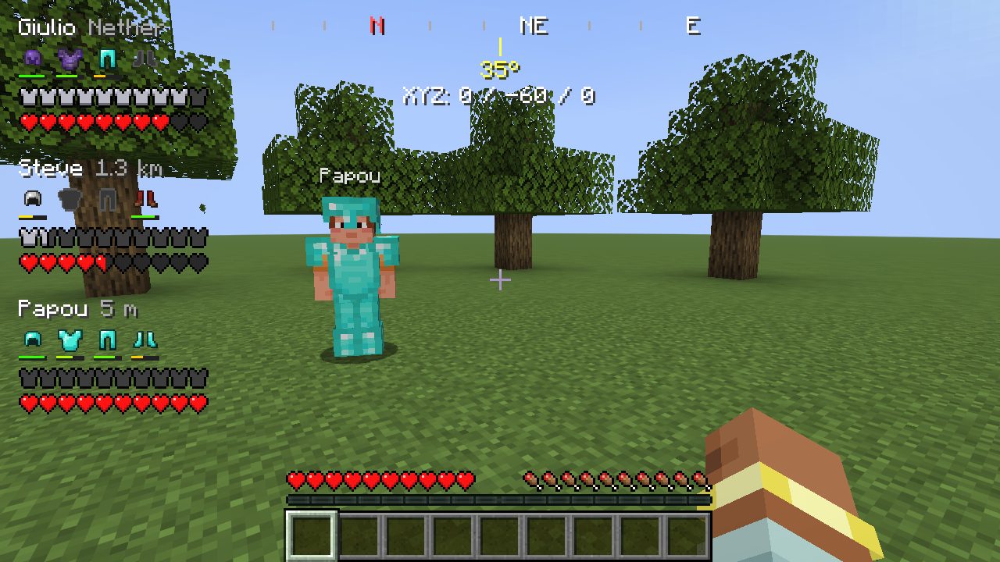
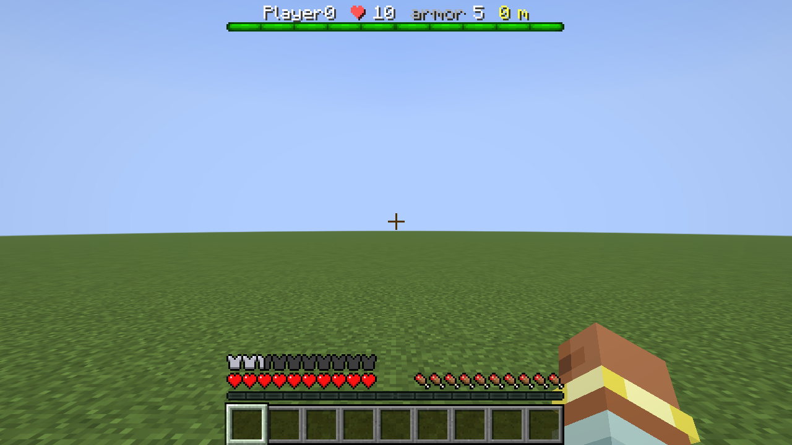

Papou HUD for **Minecraft 26.3**. Version 1.3.0 doesn't load in a 26.3 game, so install this one by hand: put `papouhud-1.4.0.jar` in `.minecraft/mods` in place of the old jar.

## New: friends far away

The friend panels now show **every player online, at any distance and in any dimension**, when the server has Papou HUD too. Next to the name, each panel shows how far away the friend is (e.g. `1.3 km`), or the dimension they're in if it isn't yours.

- **Singleplayer, Open to LAN, Essential:** works as long as the host has Papou HUD.
- **Dedicated Fabric server:** put `papouhud-1.4.0.jar` (and Fabric API) in the server's `mods` folder.
- **Paper server:** put `papouhud-paper-1.4.0.jar` (below) in the server's `plugins` folder.
- **Any other server:** the panels show the players nearby, as before.

## New: friend bars for players without the mod (Bedrock, Xbox)

On a Paper server with the plugin, players who can't have the mod, such as Bedrock players on Xbox or phone joining through Geyser, get a **bar at the top of the screen for each friend**. It shows their hearts, armor points, and the distance with an arrow pointing to them (↑ = straight ahead), or the dimension they're in. The bar empties as the friend loses health. `/papou` hides or shows the bars.

## Also

- **Safer updates:** an update made for a different Minecraft version is now refused with a message saying which version it needs, and the mod you have keeps working.
- The update check now downloads exactly `papouhud-<version>.jar`, even when the release holds other jars.

## Files

- `papouhud-1.4.0.jar`: the mod, for players (and for Fabric servers).
- `papouhud-paper-1.4.0.jar`: the plugin for Paper 26.3 servers. It doesn't go in `.minecraft/mods`.
